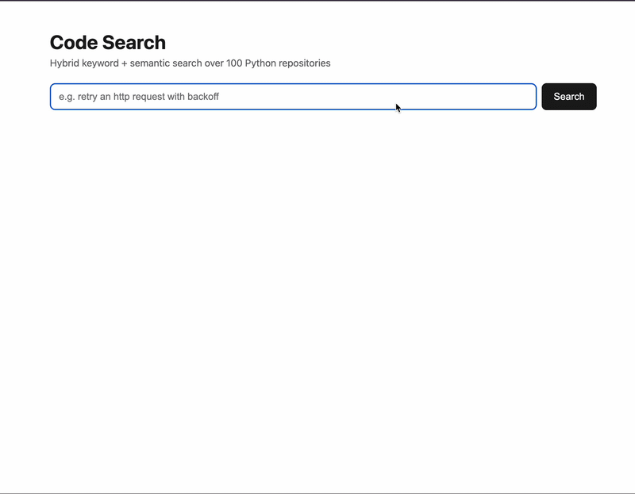

# Code Search

Hybrid keyword + semantic search over ~172K Python functions from 100 popular GitHub repositories. Type what you want a function to do, like *"retry an http request"*, and get ranked, syntax-highlighted functions with direct links to the exact lines on GitHub.



## How it works

```
GitHub API ──► clone 100 repos ──► AST chunking ──► SQLite (172K functions)
                                                         │
                                  ┌──────────────────────┴──────────────────────┐
                                  ▼                                             ▼
                        FTS5 BM25 index                          MiniLM embeddings → FAISS
                     (identifier splitting,                        (name + docstring + code)
                      field-weighted ranking)
                                  └──────────────┬──────────────────────────────┘
                                                 ▼
                                   Reciprocal Rank Fusion (k=60)
                                                 ▼
                                FastAPI /search  ──►  React UI
```

- **Chunking:** Python's `ast` module splits each file into function-level chunks (name, docstring, code, line range). Exact duplicate functions are removed.
- **Keyword search:** SQLite FTS5 with BM25 and Porter stemming. Identifiers are split so `parseJsonFile` and `read_csv` match "parse json" and "read csv". Name matches are weighted 10×, docstrings 5×, and code 1×.
- **Semantic search:** `all-MiniLM-L6-v2` embeddings with exact inner-product search in FAISS.
- **Hybrid ranking:** reciprocal rank fusion merges the top 50 results from each method without having to put their scores on the same scale.
- **API and UI:** FastAPI returns results with timing breakdowns. React plus Vite renders highlighted code with real line numbers.

## Evaluation

25 natural-language queries. For each one, the top 10 results from all three methods were pooled and labeled for relevance (498 judgments, LLM-assisted and manually reviewed). A result counts as relevant only if the function itself does what the query asks; tests and keyword-only matches don't count.

| Method | Precision@10 | MRR |
|---|---|---|
| Keyword (BM25) | 0.344 | 0.626 |
| Semantic | **0.556** | **0.877** |
| Hybrid (RRF) | **0.556** | 0.827 |

**Latency (hybrid, 125 runs, M-series MacBook, CPU):** median **40 ms**, p95 **137 ms**.

**Takeaways**
- Semantic search raises Precision@10 by 21 points over BM25. Queries rarely share exact words with the code that answers them.
- Plain RRF hybrid matched semantic on precision but ranked slightly worse on MRR. BM25 pulls test functions and keyword-only matches into the fused list. Next steps: weight the semantic results more heavily in fusion, and rank test files lower.

## Performance work

The first version of the API took about 1 s per query. Profiling each stage brought it down to 40 ms median:
- **Keyword search, 1,377 ms → about 120 ms:** BM25 ranking now runs inside the FTS5 index (`ORDER BY rank LIMIT k`) before joining to the main table, instead of scoring and joining every match. One SQLite connection is reused, and stopwords are filtered from queries.
- **Semantic search inside the server, 431 ms → about 20 ms:** queries are encoded on the CPU instead of the Mac GPU (MPS), which has too much overhead for single short queries. OpenMP is limited to one thread to avoid contention between PyTorch and FAISS, and the endpoint runs on the same thread that loaded the model.

## Run it locally

```bash
python3 -m venv .venv && source .venv/bin/activate
pip install requests tqdm sentence-transformers faiss-cpu numpy fastapi uvicorn

python backend/fetch_repos.py            # clone 100 repos (~7 min)
python backend/chunk.py                  # extract functions into SQLite
sqlite3 data/chunks.db "DELETE FROM chunks WHERE id NOT IN (SELECT MIN(id) FROM chunks GROUP BY code);"
python backend/keyword_search.py build   # FTS5 index
python backend/semantic_search.py build  # embeddings + FAISS (~20 min)

cd frontend && npm install && npm run build && cd ..
python -m uvicorn app:app --app-dir backend --port 8000   # open http://127.0.0.1:8000
```

Evaluate with `python eval/score.py`.

## Deployment

Live on AWS, with every push to `main` deployed automatically:

```
git push ──► GitHub Actions ──► docker build ──► Amazon ECR
                                                    │
                      AWS Systems Manager (SSM) ◄───┘
                                │
                                ▼
          EC2: docker pull ─► replace container ─► /health check
                     (index data mounted from S3-synced volume)
```

- **Multi-stage Dockerfile:** Node builds the React app, then a slim Python image serves it through FastAPI. The image uses CPU-only PyTorch and has the embedding model built in, so startup needs no downloads.
- **Data outside the image:** the 680 MB of index files live in S3. They're downloaded to the server once and attached to the container at runtime, so the image stays small and code deploys don't touch the data.
- **CI/CD:** a GitHub Actions workflow builds the image, tags it with the commit hash, pushes it to ECR, then uses SSM Run Command to pull and restart the container. The workflow fails if `/health` doesn't respond.
- **Security:** the server reads S3 and ECR through an IAM role, with no stored keys. GitHub deploys through SSM rather than SSH, so SSH stays limited to one IP. The deploy user can only push to this one registry and send commands to this one server.

## Tech

Python · FastAPI · SQLite FTS5 · FAISS · sentence-transformers · React · Vite · Docker · AWS (EC2, ECR, S3, SSM) · GitHub Actions
